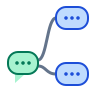

**English** · [简体中文](README.zh-CN.md)

<p align="center">
  
</p>

<h1 align="center">treui</h1>

<p align="center"><strong>A chat you can branch, drag and rewire.</strong></p>

<p align="center">A node-graph chat canvas built with Vue 3 and vis-network.</p>

Every bubble is a message, every edge is context. Drag one bubble onto another
and the conversation branches; the ancestor chain becomes the next prompt.

> **Status:** archived prototype, kept as a reference — not actively maintained.

## Quick start

Requires Node.js 16+ and an OpenAI-compatible server on
`http://localhost:8080`. The base URL is hardcoded in
[`GraphCanvas.vue`](src/components/GraphCanvas.vue); there is no environment
variable yet. Start the API server first, then:

```bash
npm ci
npm run serve
```

The dev server listens on the first free port, so it moves off 8080 when the API
server already owns it. `npm run build` writes a static bundle to `dist/`.

## What it can do now

- **Infinite canvas.** Pan, zoom, and arrange chat bubbles freely on a
  `vis-network` graph.
- **Add and edit.** Double-click empty canvas to create a bubble; double-click a
  bubble to edit its content and metadata.
- **Branch by dragging.** Drop one bubble onto another to create a parent edge.
  The dragged bubble snaps back, and the target flips between user and assistant.
- **Delete a subtree.** Select bubbles and press <kbd>Delete</kbd>; descendants go
  with them.
- **Generate from context.** An empty bubble with at least one parent streams a
  `/v1/chat/completions` response. Its prompt is the chain of ancestor nodes.
- **Per-node sampling.** Metadata is parsed as space-separated `key=value` pairs
  (`max_token=256` by default) and spread into the request body.
- **Live tokens.** Streamed deltas are appended to the bubble as they arrive.

## Architecture

```text
src/
├── App.vue                    app shell
├── components/GraphCanvas.vue canvas, editing, generation, graph state
├── api.js                     unused axios helper
└── main.js                    Vue entry point
public/index.html              HTML shell
vue.config.js                  Vue CLI 5 config
```

`GraphCanvas.vue` is the whole application. It owns the vis-network `DataSet`s,
the edit modal, drag-to-connect, subtree deletion, and the streaming `fetch`
loop. The graph _is_ the chat state: a node is a message, incoming edges are its
context, and parent nodes become the `messages` array. Everything lives in
memory — reloading the page clears the canvas. There is no backend and no
persistence.

`src/api.js` is an unused axios prototype, and `cytoscape` /
`cytoscape-dagre` are declared without being imported. Both are cleanup
candidates, not part of the current flow.

## How to develop

```bash
npm ci          # install dependencies
npm run serve   # dev server with hot reload
npm run lint    # ESLint via vue-cli-service
npm run build   # production bundle in dist/
```

The project uses the Vue 3 Composition API inside a Vue CLI 5 scaffold. Vue CLI
is in upstream maintenance mode; migrating to Vite is future work. There is no
test suite and no CI.

## How to contribute

This repository is an archive, but focused fixes are welcome. Open an issue
before a larger change so the direction can be discussed first. Keep changes
small, explain the bug and how you reproduced it, run `npm run lint`, and avoid
committing `dist/`, `node_modules/`, or local environment files. Contributions
are accepted under the AGPL-3.0-only license.

## Roadmap

### Implemented

- Infinite canvas with pan, zoom, and draggable bubbles
- Create, edit, connect, and delete bubbles and subtrees
- Parent chain → prompt → streamed OpenAI-compatible completion
- Per-node `key=value` metadata spread into the request body

### Planned

These are ideas for a revival, not commitments — the repository is archived.

- Move the API base URL and default model into config or environment variables
- Save, load, and export the graph as JSON; add persistence
- Replace the unused axios helper and remove the unused cytoscape packages
- Migrate from Vue CLI 5 to Vite
- Add tests for SSE parsing, subtree deletion, and duplicate-edge prevention
- Show request errors and support cancelling a stream
- Compare sibling branches side by side

## Future vision

The interesting part of treui is not more chat features but making conversation
topology a first-class, editable object: fork branches side by side, compare
answers, collapse a subtree into a summary, and export the whole graph as a
reusable prompt. This ~200-line prototype is a sketch of that idea.

## License

AGPL-3.0-only. See [`LICENSE`](LICENSE). Project notes live in
[`docs/project-status.md`](docs/project-status.md).
